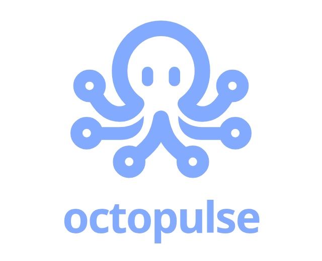
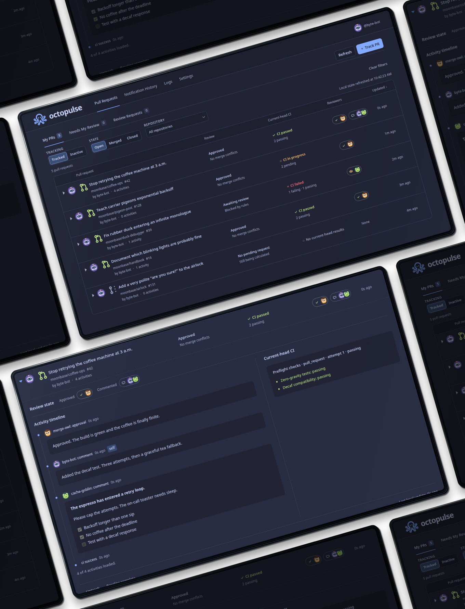

<p align="center">
  
</p>

# Octopulse

A Linux desktop app for tracking GitHub pull requests through a local web interface and desktop notifications.

Keep up with your PRs and review requests, check reviews and CI, and get notified about noteworthy activity.



## Install

Requires Linux, Node.js 24+, npm, systemd user services, and a desktop session with D-Bus for desktop notifications and tray integration.

From a checkout:

```sh
npm ci
npm run user-service:install
systemctl --user enable --now octopulse.service
```

The installer preserves existing files. Open [127.0.0.1:3000](http://127.0.0.1:3000) and use **Settings** to add a GitHub token with access to the repositories you want to monitor.

Alternatively, provide `GITHUB_TOKEN` in the service’s environment; a token saved in Settings takes precedence. Saved credentials are stored locally without encryption.

The service runs from this checkout using the current Node executable. After updating the checkout, use `npm run user-service:restart` to rebuild and restart an existing managed installation.

## Use

Open [127.0.0.1:3000](http://127.0.0.1:3000) in your browser.

Octopulse automatically discovers your open PRs and PRs requesting your review.

- Switch between **My PRs**, **Needs My Review**, and **Review Requests**, and filter by tracking status, PR state, or repository.
- Expand a PR to read activity and check reviews and CI. Use **Untrack** to stop monitoring it or **Retrack** to resume.
- Use **Track PR** to add another PR by its GitHub URL.
- Open **Notification History** to inspect past notifications or resend one; use **Logs** to investigate problems.
- Use **Settings** to change credentials, polling, retention, or optional System One bot-comment classification.

Local data is stored in `~/.local/state/octopulse/`. To run in the foreground instead of using the service, stop the service with `systemctl --user stop octopulse.service` and run `npm start`. Ctrl+C stops the foreground process.

To uninstall, run `npm run user-service:uninstall`. Local settings and data are kept unless you explicitly confirm their deletion in the interactive prompt.
